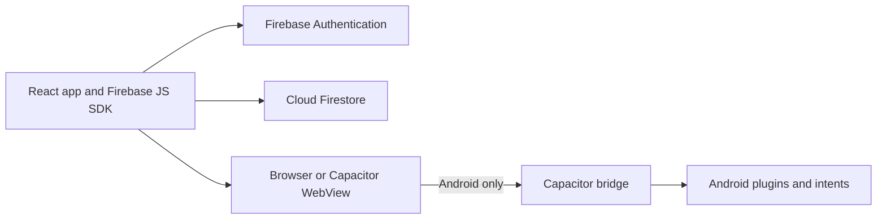

# Contri

Split trips, not friendships.

Contri helps a group organize a trip's shared expenses, see how costs split, and record who has settled up. The React app uses Firebase for sign-in and live trip data, and Capacitor packages the same web app as an Android app.

There are no product screenshots in the repository. The image assets are app artwork, icons, and Android splash resources.

## What is implemented

| Area | Current behavior |
| --- | --- |
| Sign-in | Google sign-in in the web app; native Google sign-in on Android. |
| Guest accounts | Firebase Anonymous Authentication; guests can join trips and can link Google from their profile. Guest email is optional contact information and is not verified. |
| Trips and members | Create trips, search your trip list, invite registered users by email, or join with a trip ID/invite link. |
| Expenses and balances | Add expenses with equal, percentage, shares, or exact splits; view balances, settlement suggestions, budget progress, and trip activity. |
| Settlements | Trip admins can record cash, UPI, or online settlements. |
| Notifications | Expense notifications appear in the in-app notification center while the app is running. Background Android push notifications are not implemented. |
| Profile and settings | Edit a display name, photo URL, and UPI ID; choose light, dark, or system appearance. Theme preference is stored on the current device. |
| Sharing and exports | Share trip invites and balance summaries through WhatsApp; export an expense CSV or trip-summary PDF. Android exports use the native share sheet. |
| Receipt scanning | OCR reads a selected receipt image on-device and suggests text/amounts. Tesseract.js is loaded from a CDN, so scanning needs network access to load the scanner. Receipt images are not uploaded by the scanner. |

These are capabilities present in the application code, not a claim that a production Firebase project is configured or that every feature has been manually verified on a device.

## Technology and architecture

- React 18, React Router 6, and Vite 8
- Capacitor 7 and Capacitor Android plugins
- Firebase Authentication and Cloud Firestore
- Tailwind CSS, Recharts, Lucide icons, and `react-hot-toast`
- `date-fns`, Papa Parse, jsPDF, and `jspdf-autotable`

The browser and Android app use the same React UI and Firebase data model. Capacitor supplies native Android authentication, sharing, UPI app launch, keyboard behavior, and file sharing for exports. There is no custom API server in this repository.



### Main project layout

```text
.
├── android/                 Capacitor Android project and Gradle wrapper
├── public/                  Web static assets
├── resources/               Source icon and splash images
├── shared/                  Separate platform-agnostic TypeScript utility package
├── src/
│   ├── components/          App UI, trips, expenses, settlements, feed, notifications
│   ├── context/             Authentication and theme state
│   ├── firebase/            Firebase client initialization
│   ├── hooks/               Live trip, user-trip, notification, and keyboard hooks
│   ├── lib/                 Balances, splits, exports, invites, sharing, and utilities
│   ├── pages/               Route-level screens
│   ├── routes/              Protected and public route guards
│   └── services/            Firebase authentication and data writes
├── tests/                   Node tests and Firestore rules tests
├── capacitor.config.json    Capacitor app identity and plugin configuration
├── firebase.json            Firestore rules and Auth Emulator configuration
└── firestore.rules          Firestore authorization rules
```

`shared/` has its own private package manifest and TypeScript exports; the root app does not declare it as a workspace dependency. The root npm scripts do not build or test that package separately.

## Prerequisites

For web development:

- Node.js `^20.19.0` or `>=22.12.0` (Vite 8 engine requirement)
- npm
- A Firebase project configured as described below

For Android builds, also install:

- JDK 17 or newer
- Android SDK Platform 36 and Android platform tools (`adb`)
- Android Studio or the equivalent Android SDK command-line tools
- A configured Android SDK path in `ANDROID_HOME` and `ANDROID_SDK_ROOT`

The project uses Gradle 8.11.1, Android Gradle Plugin 8.9.1, minimum Android SDK 23, compile SDK 36, and target SDK 35. Keep Java, Android SDK, and Gradle compatible with those project settings.

## Firebase project setup

Use a project you control. For development, prefer a separate Firebase project from production.

1. In Firebase Console, create a project and register a **Web app**. Copy its web configuration values into `.env` as described below.
2. Under **Authentication → Sign-in method**, enable **Google** and **Anonymous**. Google is used by web and Android sign-in; Anonymous is needed for guest access.
3. Create a Cloud Firestore database. Review `firestore.rules` and deploy the reviewed rules to the intended project before using the app against it. The repository does not select a Firebase project alias, and the production deployment state is not verified here.
4. Register an Android app with package ID `com.contriapp.mobile`. Download its `google-services.json` from Firebase Console and place it at `android/app/google-services.json`. That file is ignored by Git; do not commit it.
5. Add the relevant signing certificate SHA-1/SHA-256 fingerprints to the Android Firebase app and configure Google sign-in in Firebase Authentication. Debug and release signing certificates may differ.

### Firestore rules and indexes

- Firebase CLI configuration points to `firestore.rules` for Firestore rules. There is no Storage rules file or Cloud Storage setup in this repository. The app does not use Firebase Storage; receipt scanning is local and `receiptURL` is just an optional expense field.
- There is no checked-in `firestore.indexes.json`. If Firestore reports that a query needs a composite index, create/review the index for the intended Firebase project using the error link or Firebase Console.
- No rules deployment has been run as part of this documentation update. Do not deploy rules without confirming the Firebase project and reviewing the effect. For a deliberate staging deployment, the configured rules target can be deployed with `firebase deploy --only firestore:rules --project your-staging-project-id` after installing the Firebase CLI and replacing the placeholder with your staging project ID. This changes that project's rules; it is not a local-only command.

### Firebase client environment

Copy `.env.example` to `.env` and fill the values from the Firebase **Web app** configuration. `.env` is ignored by Git.

For sign-in and Firestore, provide the Firebase API key, Auth domain, project ID, and app ID. The app also passes the Storage bucket and messaging sender ID into Firebase initialization, but does not implement Storage or FCM features. Analytics measurement ID and the mobile invite-link origin are optional.

| Variable | Purpose |
| --- | --- |
| `VITE_FIREBASE_API_KEY` | Firebase web app API key used by the client SDK. |
| `VITE_FIREBASE_AUTH_DOMAIN` | Firebase Auth domain. |
| `VITE_FIREBASE_PROJECT_ID` | Firebase project used by Auth/Firestore client configuration. |
| `VITE_FIREBASE_STORAGE_BUCKET` | Bucket value read into Firebase client configuration; no Storage operations are implemented in this app. |
| `VITE_FIREBASE_MESSAGING_SENDER_ID` | Sender ID from the Firebase web app configuration. |
| `VITE_FIREBASE_APP_ID` | Firebase web app ID. |
| `VITE_FIREBASE_MEASUREMENT_ID` | Optional Analytics configuration; Analytics is dynamically loaded when supported. |
| `VITE_MOBILE_AUTH_URL` | Optional public web origin used to build Android invite links. If unset, the app falls back to `https://contri-app.vercel.app`. |

Firebase web configuration is client-side configuration, not a place for service-account credentials or other privileged secrets. Never put service-account keys in `.env` or the app bundle.

## Install, develop, lint, and build the web app

From the repository root:

```bash
npm ci
cp .env.example .env
# Fill .env with your own Firebase web app values.
npm run dev
```

Vite listens on port `5173` and binds to all interfaces (`host: true`). The development server requires a valid Firebase configuration for sign-in and data features.

Available root commands:

| Command | Purpose |
| --- | --- |
| `npm run dev` | Start the Vite development server. |
| `npm run lint` | Run ESLint across the repository. |
| `npm test` | Run Node tests with the Firestore and Auth Emulators. |
| `npm run build` | Create the production web build in `dist/`. |
| `npm run preview` | Preview the built web app locally. |
| `npm run cap:sync` | Sync the built web app and Capacitor plugins into Android. |
| `npm run cap:open` | Open the Android project in Android Studio. |
| `npm run android:debug` | Assemble a debug APK through the Gradle wrapper. |
| `npm run assets:android` | Regenerate Android icon/splash resources from `resources/`. |

Run the common checks with:

```bash
npm run lint
npm test
npm run build
```

## Firestore Emulator and tests

The test script runs against the demo project ID `demo-contri-notifications`, not a production Firebase project:

```bash
npm install -g firebase-tools
npm test
```

The script starts only the Firestore and Auth Emulators, runs `node --test tests/*.test.js`, and stops the emulators afterward. The Auth Emulator port is set to `9099` in `firebase.json`; Firestore uses the Emulator Suite default port `8080`. Rules tests load `firestore.rules` directly and clear emulator test data between cases. No production records are read or modified by this command.

The Firebase CLI and a Java runtime are needed to run the Emulator Suite.

The checked-in tests cover selected Firestore authorization and guest/expense/notification flows, plus theme preference behavior. They are not end-to-end UI tests and do not verify a live Firebase project or physical Android device.

## Using the app

1. Sign in with Google, or choose **Join as Guest**.
2. Create a trip or join using its invite link/trip ID. A trip admin can also invite an already registered user by email.
3. Add travelers and expenses, choose split participants and split mode, and review the balance/settlement suggestions.
4. Record settlements, follow the activity feed, and share or export the trip summary as needed.
5. Add a UPI ID to your profile if you want it available for UPI settlement flows.

Treat trip IDs and invite links as private. The checked-in rules allow an authenticated user who has a trip ID to self-join that trip; a link is therefore an access path, not merely a read-only preview.

### Guest account limitations

Guest sessions use Firebase Anonymous Authentication. The optional email collected for a guest is contact information only, is not verified, and is not the Firebase sign-in email. Anonymous accounts can be difficult to recover after sign-out or loss of the device. Link Google from the guest profile to retain the same Firebase UID and trip access.

## Firestore data and authorization

The app stores user profiles in `users/{uid}`. Trips and their records are organized as:

```text
trips/{tripId}
├── expenses/{expenseId}
├── settlements/{settlementId}
└── activity/{activityId}

users/{uid}/notifications/{tripId}_{expenseId}
```

The trip document holds trip details, embedded member profiles, `memberIds`, `adminIds`, and creator/timestamp fields. Expenses, settlements, and activity are separate subcollections. Expense-created notifications use deterministic IDs and are written with the expense/activity batch.

The checked-in `firestore.rules` enforces these main boundaries:

- A signed-in user creates their own trip; trip reads are limited to members/creator.
- Authenticated users can self-join a trip when they know its ID. Trip admins can manage trip details, invite members, change roles, and delete the trip.
- Trip members can read trip records and create expenses attributed to themselves. Only admins can edit or delete expenses.
- Only trip admins can create, update, or delete settlement documents under the current rules. The current UI exposes settlement recording to admins, not settlement edit/delete controls.
- Members can create activity attributed to themselves; only admins can delete activity.
- Users can write their own profile. The rules also allow non-anonymous signed-in users to read user documents for account lookup; anonymous users can read their own profile.
- A user can read only their own notifications and can only change an unread notification to read. Notification creation is restricted to the trip's member/expense workflow.

These rules are source configuration, not evidence that they are deployed to any Firebase project. Always verify the target project and existing rules before deployment.

### Notifications and service limits

Notifications are an **in-app, foreground/live Firestore feature**. The app subscribes to notification data while a signed-in session is open. It does not configure FCM delivery, a Cloud Function, or another trusted background sender; background Android push is not implemented.

Firebase usage quotas and pricing depend on the Firebase plan, enabled products, and project usage; this repository does not configure budgets or billing alerts. The app does not require Storage for its current receipt scanning flow and does not configure Cloud Functions or a push-notification backend. Check current Firebase Console plan requirements before enabling additional products.

## Capacitor Android app

The Android app is a Capacitor shell around the Vite build. The configured app ID is `com.contriapp.mobile`; `webDir` is `dist`.

1. Install the Android prerequisites above and configure the SDK environment:

   ```bash
   export ANDROID_HOME="$HOME/Android/Sdk"
   export ANDROID_SDK_ROOT="$ANDROID_HOME"
   ```

   Adjust the path for your machine. Ensure `java`, `adb`, and the Android SDK Platform 36 are available.
2. Configure `.env` and place the Android Firebase app configuration at `android/app/google-services.json`. For Google sign-in, make sure the app registration and certificate fingerprints match the signing key you use.
3. Build the web app, sync it to Capacitor, and assemble the debug APK:

   ```bash
   npm run build
   npm run cap:sync
   npm run android:debug
   ```

   The APK is written to `android/app/build/outputs/apk/debug/app-debug.apk`.
4. Install on a connected device with USB debugging enabled:

   ```bash
   adb install -r android/app/build/outputs/apk/debug/app-debug.apk
   ```

Run `npm run cap:sync` again after changing web assets or native plugins. To open the project in Android Studio, use `npm run cap:open`.

### Release build status

The Gradle project has a `release` build type, but no release keystore/signing configuration is checked in. A release APK can be assembled with:

```bash
cd android
./gradlew assembleRelease
```

Before distributing a release, configure signing securely outside tracked source files, register the release certificate fingerprints with Firebase for Google sign-in, and manually test the signed build. Do not commit keystores or signing passwords. Release distribution and Play Store publishing are not configured in this repository.

If `resources/icon.png` or `resources/splash.png` changes, regenerate the native assets with `npm run assets:android`.

## Web deployment

`npm run build` writes static files to `dist/`. `vercel.json` contains an SPA rewrite to `index.html`, suitable for client-side routes. The repository has no web deployment npm script or checked-in GitHub Actions workflow. Configure the hosting provider manually with build command `npm run build`, output directory `dist`, and the Firebase environment variables from the deployment's own environment settings.

The app has a default public web URL used when constructing Android invite links. Set `VITE_MOBILE_AUTH_URL` to the actual HTTPS web origin for the deployment you intend Android invites to open.

## Troubleshooting

### Trips or trip data do not appear

- Confirm you are signed into the same Firebase project/account used by the trip.
- Join with the correct trip ID/invite link. A user who is not a member cannot read trip records under the checked-in rules.
- Check the browser console for Firestore errors and use the app's retry actions. Verify the app's environment values point to the intended Firebase project.

### `Missing or insufficient permissions`

- Check membership and role in the target trip, then compare the requested operation with the rules above. For example, settlement writes currently require a trip admin.
- Confirm reviewed `firestore.rules` are deployed to the same Firebase project selected by the app. Do not deploy rules to production merely as a troubleshooting shortcut; inspect the target project's current rules and data-access needs first.
- If Firestore reports a missing index, review and create the required index in the intended Firebase project. There is no index manifest in this repository.

### Google sign-in fails

- Verify Google is enabled in Firebase Authentication.
- For Android, check `android/app/google-services.json`, the `com.contriapp.mobile` package registration, and SHA-1/SHA-256 fingerprints for the signing certificate. Debug and release certificates are different.
- For web, use a configured Firebase Auth domain and allow the local/deployed domain in Firebase Authentication's authorized domains.

### Android keyboard, safe areas, or stale app content

- Rebuild the web app and run `npm run cap:sync` before rebuilding/reinstalling Android.
- The app uses Capacitor's keyboard plugin and CSS safe-area insets. Verify the device's Android/WebView version and test on the target device if fields or bottom navigation are obscured.

### Build or emulator command fails

- Check Node.js against Vite's `^20.19.0 || >=22.12.0` requirement and reinstall locked dependencies with `npm ci`.
- If Gradle reports `SDK location not found`, install the Android SDK and set `ANDROID_HOME` and `ANDROID_SDK_ROOT` to its location, as shown above. Also check the selected JDK, SDK Platform 36, and Gradle output.
- For `npm test`, install the Firebase CLI and ensure ports `8080` (Firestore) and `9099` (Auth) are available. The command should run with the demo project ID, never a production project.

## Known gaps and manual verification

- No screenshots, deployment workflow, Firestore index manifest, Storage rules, push-notification backend, or Android release signing configuration are checked in.
- Production Firebase project settings and rules deployment status have not been inspected or verified as part of this documentation task.
- Manually verify Google sign-in on the web and Android, guest account linking/recovery expectations, sharing/UPI intents, CSV/PDF share behavior, receipt scanning with network access, and keyboard/safe-area behavior on target devices.
- A `LICENSE` file is not included in the repository; no license terms are stated here.

## Contributing

No separate contribution guide is included. Before opening a change, run `npm run lint`, `npm test`, and `npm run build` where applicable. Keep Firebase credentials, Android client configuration, and signing material out of Git. Do not run deployment commands against a production Firebase project without explicit review and approval.
